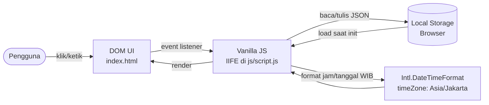
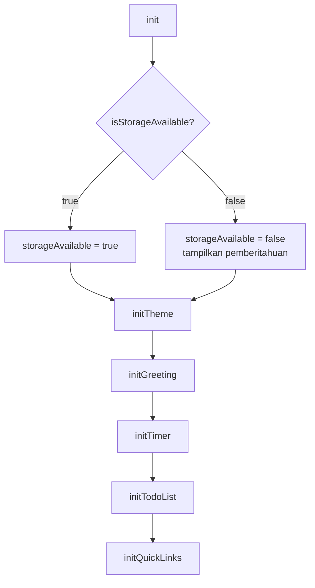

# Design Document — Life Dashboard

> Ringkasan Revisi Teknis yang diterapkan di dokumen ini:
> 1. **Zona Waktu WIB** — Jam, tanggal, dan sapaan menggunakan `Intl.DateTimeFormat` dengan `timeZone: "Asia/Jakarta"`, bukan `new Date().getHours()`.
> 2. **Cegah Duplikat saat Edit** — `isDuplicateTask(text, tasks, excludeId)` menerima `excludeId` agar tugas yang sedang diedit tidak dianggap duplikat dirinya sendiri.
> 3. **Validasi URL Quick Links** — `normalizeUrl()` menambah `https://`, lalu `new URL()` memvalidasi hanya protocol `http:` dan `https:`.
> 4. **Penanganan Kegagalan Local Storage** — `isStorageAvailable()` dicek di `init()`; data di memori adalah sumber truth UI; jika `save` gagal, UI TIDAK di-rollback.
> 5. **Perbaikan Focus Timer** — Sistem berbasis `Date.now()` (timestamp) agar drift-free; `setInterval(updateTimerDisplay, 250)`; `pauseTimer()` menghitung `remainingMs` sebelum `clearInterval`.
> 6. **Validasi Tema & Data Local Storage** — `initTheme()` default `"light"` jika invalid; `validateTask()`/`validateLink()` memfilter item rusak tanpa menghapus yang valid.
> 7. **Pengujian** — Manual testing via browser + contoh property test sederhana memakai `console.assert` tanpa library eksternal.

---

## Overview

### 1.1 Deskripsi Aplikasi

Life Dashboard adalah aplikasi web "To-Do List Life Dashboard" yang berfungsi sebagai dashboard produktivitas harian. Aplikasi menampilkan empat fitur wajib dalam bentuk kartu terpisah dan tiga additional challenges.

Empat fitur wajib:
- **Greeting Panel** — jam real-time (WIB), tanggal bahasa Indonesia, sapaan berbasis waktu, dan custom name.
- **Focus Timer** — Pomodoro 25 menit dengan Start/Stop/Reset dan countdown akurat.
- **To-Do List** — tambah, edit, tandai selesai, hapus tugas dengan persistensi Local Storage dan pencegahan duplikat.
- **Quick Links** — tampilkan, tambah, dan buka tautan website favorit dengan persistensi Local Storage.

Tiga additional challenges:
- **Light/Dark Mode**
- **Custom Name in Greeting**
- **Prevent Duplicate Tasks**

### 1.2 Sasaran Desain

- **Sederhana & Mudah Dipelihara** — satu file CSS dan satu file JavaScript, struktur folder tetap.
- **Berjalan Tanpa Backend** — seluruh logika di sisi klien, data di Local Storage.
- **Aksesibel untuk Pemula** — kode dipisah ke dalam function bernama, komentar dalam bahasa Indonesia (Requirement 29).
- **Konsisten** — satu set nama fungsi, storage key, dan model data dipakai di seluruh dokumen.
- **Tangguh terhadap Kegagalan** — aplikasi tetap berfungsi (data di memori) walau Local Storage tidak tersedia.

### 1.3 Tech Stack

| Lapisan | Teknologi | File |
|--------|-----------|-----|
| Struktur | HTML5 | `index.html` |
| Tampilan | CSS3 (satu file, CSS variables) | `css/style.css` |
| Logika | Vanilla JavaScript (IIFE, tanpa framework/library) | `js/script.js` |
| Penyimpanan | Browser Local Storage API | — |
| Deployment | GitHub Pages (relative paths) | — |

Tidak ada framework, library eksternal, transpiler, build step, backend, atau database.

### 1.4 Batasan & Asumsi

- Aplikasi harus berjalan di Chrome, Firefox, Edge, Safari versi stabil terbaru.
- Data hilang dari memori saat halaman di-refresh jika Local Storage tidak tersedia; Local Storage menyimpan secara permanen.
- Zona waktu yang dipakai untuk jam, tanggal, dan sapaan adalah WIB (Asia/Jakarta, UTC+7) — tidak mengikuti zona perangkat.

---

## Architecture

### 2.1 Diagram Alur Data



Aplikasi adalah loop tunggal: pengguna berinteraksi dengan DOM → event listener memanggil function di JavaScript → function memperbarui data di memori → merender ulang DOM → menyimpan ke Local Storage. Semua persistensi melalui Local Storage; tidak ada panggilan jaringan.

### 2.2 Alur Inisialisasi

Urutan inisialisasi wajib (dipakai konsisten di seluruh dokumen):

```
init()
  → isStorageAvailable()      // cek Local Storage, simpan ke storageAvailable
  → initTheme()               // terapkan tema tersimpan atau default "light"
  → initGreeting()            // mulai jam, tanggal, sapaan, muat nama
  → initTimer()                // set display 25:00, status berhenti
  → initTodoList()            // muat tasks, render, pasang listener
  → initQuickLinks()          // muat links, render, pasang listener
```



### 2.3 Keputusan Desain Utama

| Keputusan | Alasan |
|-----------|--------|
| **IIFE** membungkus seluruh `js/script.js` | Menghindari polusi global scope tanpa memerlukan modul ES (menjaga satu file sederhana). |
| **Modul via komentar** di dalam IIFE | Memenuhi Requirement 28.2 (pisahkan logika ke function bernama) dan Requirement 29 (komentar Indonesia). |
| **`Date.now()` timestamp** untuk timer | Drift-free: tidak bergantung pada akurasi `setInterval`, hanya menghitung selisih waktu nyata. |
| **`Intl.DateTimeFormat` WIB** untuk jam/tanggal/sapaan | Konsisten dengan WIB terlepas dari zona perangkat pengguna. |
| **Data di memori = sumber truth UI** | UI tetap menampilkan data walau Local Storage gagal; persistensi adalah lapisan terpisah. |
| **Relative paths** untuk semua aset | Mendukung GitHub Pages tanpa modifikasi path. |
| **`data-theme` attribute** untuk tema | Pemilihan tema via CSS selector, tanpa reload halaman. |
| **`addEventListener`** untuk semua interaksi | Memenuhi Requirement 28.3, bukan inline `onclick`. |

### 2.4 Struktur Folder (Tetap, Tidak Boleh Diubah/Ditambah)

```
Life-Dashboard/
├── index.html
├── css/
│   └── style.css        # SATU file CSS
├── js/
│   └── script.js        # SATU file JavaScript (IIFE)
└── .kiro/
```

Tidak boleh ada file `.css` atau `.js` lain di mana pun dalam proyek (Requirement 2.4).

---

## Components and Interfaces

JavaScript di `js/script.js` dibungkus satu IIFE dan dibagi menjadi tujuh modul logis (dipisah oleh komentar berbahasa Indonesia). Berikut function signature lengkap untuk setiap modul.

### 3.1 Storage Helper

Lapisan persistensi. Semua baca/tulis Local Storage melewati modul ini.

```javascript
// === MODUL: Storage Helper ===
function isStorageAvailable()             // → boolean  : uji ketersediaan Local Storage
function saveData(key, data)             // → boolean  : simpan data sebagai JSON, false jika gagal
function loadData(key, fallback)         // → any      : baca & parse JSON, kembalikan fallback jika gagal
function generateId()                    // → string   : id unik dari Date.now() + Math.random()
```

### 3.2 Theme Manager

```javascript
// === MODUL: Theme Manager ===
function initTheme()                     // → void : baca tema tersimpan, terapkan, atau default "light"
function applyTheme(theme)               // → void : set document.body.dataset.theme = theme
function toggleTheme()                   // → void : balik tema light↔dark dan simpan
function saveTheme(theme)                // → void : simpan tema ke Local Storage (try/catch)
```

### 3.3 Greeting Panel

```javascript
// === MODUL: Greeting Panel ===
function initGreeting()                  // → void        : pasang listener nama, mulai updateClock()
function updateClock()                   // → void        : render jam HH:MM:SS, tanggal, dan sapaan (WIB)
function getWibHour()                    // → number 0-23 : ekstrak jam WIB dari Intl.DateTimeFormat
function getGreeting(hour)               // → string      : "Selamat pagi/siang/sore/malam" berdasarkan jam
function renderGreeting(greeting, name)   // → void        : tampilkan sapaan + nama ke DOM
function saveUserName(name)              // → boolean     : validasi & simpan nama (1-50 char) ke Local Storage
function loadUserName()                  // → string|""   : muat nama dari Local Storage
function renderUserName(name)            // → void        : tampilkan nama di DOM (string kosong jika tanpa nama)
```

### 3.4 Focus Timer

```javascript
// === MODUL: Focus Timer ===
function initTimer()                     // → void   : set display 25:00, status "stopped", pasang listener
function startTimer()                    // → void   : mulai/melanjutkan countdown berbasis timestamp
function pauseTimer()                    // → void   : hentikan interval, simpan remainingMs, status "paused"
function resetTimer()                    // → void   : hentikan interval, kembalikan 25:00, status "stopped"
function stopInterval()                  // → void   : clearInterval dan set intervalId = null
function updateTimerDisplay()           // → void   : hitung remainingMs, render MM:SS, atau panggil timerComplete()
function formatTime(totalSeconds)        // → string : format "MM:SS" dengan leading zeros
function timerComplete()                 // → void   : hentikan, set 00:00, tampilkan notifikasi "Sesi selesai!"
```

### 3.5 Todo List

```javascript
// === MODUL: Todo List ===
function initTodoList()                  // → void     : muat tasks, render, pasang listener form
function addTask(event)                  // → void     : validasi, cek duplikat, tambah task baru, simpan
function editTask(id)                    // → void     : aktifkan mode edit pada task di DOM
function saveEditTask(id)                // → void     : validasi edit, cek duplikat (excludeId), simpan
function toggleTaskComplete(id)          // → void     : balik status completed, simpan
function deleteTask(id)                  // → void     : hapus task, simpan, tangani kegagalan storage
function renderTaskList()                // → void     : render ulang semua task dari state memori
function isDuplicateTask(text, tasks, excludeId) // → boolean : cek duplikat case-insensitive + trim, exclude diri sendiri
function saveTasks()                     // → boolean : simpan tasks ke Local Storage via saveData()
function loadTasks()                     // → array   : muat & validasi tasks; kembalikan array valid
function validateTask(item)              // → boolean : cek struktur item task (id, text, completed)
```

### 3.6 Quick Links

```javascript
// === MODUL: Quick Links ===
function initQuickLinks()                // → void     : muat links, render, pasang listener form
function addQuickLink(event)             // → void     : validasi, normalisasi URL, tambah link, simpan
function openQuickLink(url)              // → void     : buka URL di tab baru jika valid
function renderLinkList()                // → void     : render ulang semua link dari state memori
function isValidUrl(url)                 // → boolean : normalisasi lalu cek protocol http/https via new URL()
function normalizeUrl(url)               // → string  : tambah "https://" jika tidak ada protocol
function saveLinks()                     // → boolean : simpan links ke Local Storage via saveData()
function loadLinks()                     // → array   : muat & validasi links; kembalikan array valid
function validateLink(item)              // → boolean : cek struktur item link (id, name, url)
```

### 3.7 Initialization

```javascript
// === MODUL: Initialization (entry point) ===
function init()                          // → void : cek storage, lalu inisialisasi semua modul sesuai urutan
```

### 3.8 State Global (di dalam IIFE)

```javascript
let storageAvailable = false;             // hasil isStorageAvailable()
let tasks = [];                          // state To-Do List di memori
let links = [];                          // state Quick Links di memori
let timerState = { remainingMs, intervalId, endTimestamp, status }; // lihat Data Models
```

---

## Data Models

### 4.1 Schema Local Storage (4 Key)

Semua disimpan sebagai string JSON via `JSON.stringify`. Nama key dipakai konsisten di seluruh dokumen.

| Key | Tipe JSON | Deskripsi | Modul pengelola |
|-----|-----------|-----------|------------------|
| `life_dashboard_tasks` | array of `Task` | Daftar tugas pengguna | Todo List |
| `life_dashboard_links` | array of `QuickLink` | Daftar tautan cepat | Quick Links |
| `life_dashboard_theme` | string `"light"` \| `"dark"` | Tema aktif yang dipilih | Theme Manager |
| `life_dashboard_name` | string | Nama pengguna untuk sapaan (maks 50 char) | Greeting Panel |

### 4.2 Model Data

**Task** (To-Do List item):

```javascript
{
  id: string,        // generateId() — unik
  text: string,      // 1-255 karakter setelah trim, bukan duplikat
  completed: boolean  // true = selesai (strikethrough), false = belum
}
```

**QuickLink** (Quick Links item):

```javascript
{
  id: string,   // generateId() — unik
  name: string,  // 1+ karakter setelah trim
  url: string    // URL lengkap dengan protocol http:// atau https://
}
```

**TimerState** (in-memory saja, tidak disimpan ke Local Storage):

```javascript
{
  remainingMs: number,        // sisa waktu dalam milidetik; default 25 * 60 * 1000
  intervalId: number | null,  // id dari setInterval; null jika tidak berjalan
  endTimestamp: number | null, // Date.now() + remainingMs saat Start; null jika berhenti
  status: "stopped" | "running" | "paused"
}
```

**ThemeState**: disimpan sebagai string sederhana (`"light"` atau `"dark"`) di `life_dashboard_theme`. Tidak perlu objek.

### 4.3 Catatan Sumber Truth

- `tasks` dan `links` (array di memori) adalah **sumber truth untuk UI** selama sesi berjalan.
- Local Storage adalah **persistensi permanen** — dibaca saat `init()` dan ditulis setiap perubahan.
- Jika `saveTasks()`/`saveLinks()` gagal, data tetap ada di memori dan UI tetap menampilkannya; perubahan pengguna tidak di-rollback.
- Jika Local Storage tidak tersedia, data hanya hidup di memori (hilang saat refresh).

---

## HTML Structure

`index.html` memakai semantic HTML5. Setiap elemen yang dirujuk JavaScript memiliki `id`. Komentar dalam bahasa Indonesia mengidentifikasi tiap section (Requirement 29.4). Semua path aset relatif (Requirement 4.2).

```html
<!DOCTYPE html>
<html lang="id">
<head>
  <meta charset="UTF-8" />
  <meta name="viewport" content="width=device-width, initial-scale=1.0" />
  <title>Life Dashboard</title>
  <!-- Memuat satu file CSS relatif -->
  <link rel="stylesheet" href="css/style.css" />
</head>
<body>
  <!-- Header: judul aplikasi dan tombol ganti tema -->
  <header class="app-header">
    <h1>Life Dashboard</h1>
    <button id="theme-toggle" type="button" aria-label="Ganti tema terang/gelap">🌙</button>
  </header>

  <!-- Main: area utama berisi empat kartu fitur -->
  <main class="dashboard">

    <!-- Kartu 1: Panel Sapaan (jam, tanggal, sapaan, nama) -->
    <section id="greeting-panel" class="card">
      <h2 class="card-title">Halo</h2>
      <div id="clock-time" class="clock-time">00:00:00</div>
      <div id="current-date" class="current-date">-</div>
      <div class="greeting-row">
        <span id="greeting-text" class="greeting-text">Selamat datang</span>
        <span id="user-name" class="user-name"></span>
      </div>
      <div class="name-input-group">
        <input id="name-input" type="text" maxlength="50"
               placeholder="Masukkan nama (maks 50 karakter)" />
        <button id="save-name-btn" type="button">Simpan Nama</button>
        <button id="clear-name-btn" type="button">Hapus Nama</button>
      </div>
      <p id="name-message" class="name-message"></p>
    </section>

    <!-- Kartu 2: Focus Timer (Pomodoro 25 menit) -->
    <section id="focus-timer" class="card">
      <h2 class="card-title">Focus Timer</h2>
      <div id="timer-display" class="timer-display">25:00</div>
      <div id="timer-status" class="timer-status">Berhenti</div>
      <div class="timer-controls">
        <button id="timer-start" type="button">Start</button>
        <button id="timer-stop" type="button">Stop</button>
        <button id="timer-reset" type="button">Reset</button>
      </div>
    </section>

    <!-- Kartu 3: To-Do List -->
    <section id="todo-list" class="card">
      <h2 class="card-title">To-Do List</h2>
      <form id="todo-form" class="todo-form">
        <input id="task-input" type="text" maxlength="255"
               placeholder="Tulis tugas lalu tekan Enter..." />
        <button type="submit">Tambah</button>
      </form>
      <p id="task-message" class="task-message"></p>
      <ul id="task-list" class="task-list" aria-live="polite"></ul>
      <p id="todo-empty" class="empty-message">Belum ada tugas.</p>
    </section>

    <!-- Kartu 4: Quick Links -->
    <section id="quick-links" class="card">
      <h2 class="card-title">Quick Links</h2>
      <form id="link-form" class="link-form">
        <input id="link-name" type="text" placeholder="Nama link..." />
        <input id="link-url" type="text" placeholder="https://contoh.com" />
        <button type="submit">Tambah Link</button>
      </form>
      <p id="link-message" class="link-message"></p>
      <p id="links-empty" class="empty-message">Belum ada link tersimpan.</p>
      <div id="link-list" class="link-list" aria-live="polite"></div>
    </section>

  </main>

  <!-- Footer: informasi proyek -->
  <footer class="app-footer">
    <p>Life Dashboard — Mini Project CodingCamp RevoU</p>
  </footer>

  <!-- Memuat satu file JavaScript relatif, di akhir body -->
  <script src="js/script.js"></script>
</body>
</html>
```

### 5.1 DOM ID Reference

| ID | Modul pengelola | Kegunaan |
|----|-----------------|----------|
| `theme-toggle` | Theme Manager | Tombol ganti tema |
| `clock-time`, `current-date`, `greeting-text`, `user-name` | Greeting | Jam, tanggal, sapaan, nama |
| `name-input`, `save-name-btn`, `clear-name-btn`, `name-message` | Greeting | Input nama |
| `timer-display`, `timer-status`, `timer-start`, `timer-stop`, `timer-reset` | Focus Timer | Kontrol timer |
| `todo-form`, `task-input`, `task-list`, `task-message`, `todo-empty` | Todo List | Form & list tugas |
| `link-form`, `link-name`, `link-url`, `link-list`, `link-message`, `links-empty` | Quick Links | Form & list link |

Item tugas/link di-render dinamis dengan id berbasis `task.id`/`link.id` (mis. `task-${id}`, `delete-${id}`).

---

## CSS Design System

`css/style.css` memakai CSS custom properties (variables) dan attribute selector `[data-theme]`. Komentar dalam bahasa Indonesia mengidentifikasi tiap kelompok aturan (Requirement 29.3).

### 6.1 Design Tokens (CSS Variables)

```css
:root {
  /* === Token dasar: tipografi === */
  --font-body: 16px;     /* minimum body 16px (Req 25.4) */
  --font-heading: 24px;  /* minimum heading 24px, 1.5x body (Req 25.3) */
  --font-label: 14px;    /* minimum label 14px (Req 25.4) */
  --radius: 12px;
  --transition: 200ms;   /* transisi 100-300ms (Req 27.2) */
  --space-card: 16px;     /* jangan antar kartu minimum 16px (Req 25.1) */
  --target-min: 44px;     /* target interaktif minimum 44x44px (Req 27.3) */
  --max-width: 1024px;
}

/* === Tema Terang (default) === */
[data-theme="light"] {
  --color-bg: #f5f7fa;        /* warna 1: latar dashboard */
  --color-card: #ffffff;       /* warna 2: latar kartu */
  --color-text: #1a202c;       /* warna 3: teks utama */
  --color-primary: #4f46e5;    /* warna 4: aksi utama (indigo) */
  --color-accent: #10b981;     /* warna 5: sukses/selesai (hijau) */
  --color-border: #e2e8f0;
}

/* === Tema Gelap === */
[data-theme="dark"] {
  --color-bg: #0f172a;
  --color-card: #1e293b;
  --color-text: #f1f5f9;
  --color-primary: #818cf8;
  --color-accent: #34d399;
  --color-border: #334155;
}
```

**Palet warna**: tepat 5 warna primer per tema (`--color-bg`, `--color-card`, `--color-text`, `--color-primary`, `--color-accent`), memenuhi Requirement 25.2 (≤5 warna primer).

### 6.2 Aturan Layout & Kartu

```css
/* === Layout: dashboard grid yang responsif === */
.dashboard {
  max-width: var(--max-width);
  margin: 0 auto;
  display: grid;
  gap: var(--space-card);   /* jangan antar kartu 16px (Req 25.1) */
  padding: 16px;
}

/* === Kartu: batas + bayangan + latar berbeda (Req 25.1) === */
.card {
  background: var(--color-card);
  color: var(--color-text);
  border: 1px solid var(--color-border);
  border-radius: var(--radius);
  box-shadow: 0 2px 8px rgba(0,0,0,0.08);
  padding: 20px;
}

/* === Tipografi: hierarki visual (Req 25.3, 25.4) === */
.card-title { font-size: var(--font-heading); }
body { font-size: var(--font-body); }
label, .timer-status, .name-message { font-size: var(--font-label); }
```

### 6.3 Interaktif & Feedback

```css
/* === Interaktif: hover, fokus, transisi (Req 27) === */
button, input {
  min-height: var(--target-min);   /* target 44px (Req 27.3) */
  font: inherit;
}
button, a {
  transition: background var(--transition), box-shadow var(--transition);
}
/* Hover: ubah minimal 1 properti (Req 27.1) */
button:hover { background: var(--color-primary); color: #fff; }
/* Fokus: indikator terlihat (Req 27.4) */
button:focus-visible, input:focus-visible {
  outline: 3px solid var(--color-primary);
  outline-offset: 2px;
}
/* Strikethrough untuk tugas selesai (Req 16.1) */
.task-text.completed { text-decoration: line-through; }
```

### 6.4 Breakpoint Responsif

```css
/* === Mobile-first: layar ≤480px (Req 26.2) === */
@media (max-width: 480px) {
  .dashboard { grid-template-columns: 1fr; }   /* satu kolom */
  .name-input-group, .timer-controls { flex-direction: column; }
}
/* === Tablet/lebar ≥1024px (Req 26.1) === */
@media (min-width: 1024px) {
  .dashboard { grid-template-columns: repeat(2, 1fr); }
}
```

Mobile-first: default satu kolom untuk layar kecil, dua kolom untuk layar ≥1024px, tanpa horizontal scroll di rentang 480px–1024px maupun ≥1024px.

---

## Key Algorithms

Seluruh kode memakai `const`/`let` (tidak ada `var` — Requirement 28.1), nama camelCase ≥3 karakter (Requirement 28.4), dan komentar berbahasa Indonesia (Requirement 29.1).

### 7.1 Storage Helper

```javascript
// Cek apakah Local Storage dapat dipakai (Req 18.4, 23.3)
function isStorageAvailable() {
  try {
    const testKey = "__storage_test__";
    localStorage.setItem(testKey, "1");
    localStorage.getItem(testKey);
    localStorage.removeItem(testKey);
    return true;
  } catch (error) {
    return false;
  }
}

// Simpan data sebagai JSON; kembalikan false jika gagal (jangan rollback UI)
function saveData(key, data) {
  if (!storageAvailable) {
    return false; // Local Storage tidak tersedia: data tetap di memori
  }
  try {
    localStorage.setItem(key, JSON.stringify(data));
    return true;
  } catch (error) {
    // QuotaExceededError atau lainnya: tampilkan pesan, JANGAN hapus data dari memori
    console.error("Gagal menyimpan ke Local Storage:", error);
    return false;
  }
}

// Baca & parse JSON; kembalikan fallback jika gagal/kosong
function loadData(key, fallback) {
  if (!storageAvailable) {
    return fallback;
  }
  try {
    const raw = localStorage.getItem(key);
    if (raw === null) {
      return fallback;
    }
    return JSON.parse(raw);
  } catch (error) {
    // Data rusak: kembalikan fallback agar aplikasi tetap jalan
    return fallback;
  }
}

// Hasilkan id unik dari timestamp + random
function generateId() {
  return Date.now().toString(36) + Math.random().toString(36).slice(2, 9);
}
```

### 7.2 Theme Manager

```javascript
// Inisialisasi tema: terapkan tersimpan, atau default "light" (Req 24.4, 24.5)
function initTheme() {
  const saved = loadData("life_dashboard_theme", "");
  if (saved === "light" || saved === "dark") {
    applyTheme(saved);
  } else {
    applyTheme("light"); // default jika invalid/kosong/tidak tersedia
  }
}

// Terapkan tema ke body tanpa reload (Req 24.1, 24.2)
function applyTheme(theme) {
  document.body.dataset.theme = theme;
}

// Balik tema dan simpan
function toggleTheme() {
  const current = document.body.dataset.theme || "light";
  const next = current === "light" ? "dark" : "light";
  applyTheme(next);
  saveTheme(next);
}

// Simpan tema (try/catch agar tidak melempar error)
function saveTheme(theme) {
  saveData("life_dashboard_theme", theme);
}
```

### 7.3 Greeting Panel (WIB)

```javascript
// Ekstrak jam WIB (0-23) dari Intl.DateTimeFormat
function getWibHour() {
  const formatter = new Intl.DateTimeFormat("id-ID", {
    timeZone: "Asia/Jakarta",
    hour: "2-digit",
    hour12: false
  });
  const hourString = formatter.format(new Date());
  let hour = parseInt(hourString, 10);
  // Beberapa engine mengembalikan "24" di tengah malam; normalisasi ke 0
  if (hour === 24) {
    hour = 0;
  }
  return hour;
}

// Tentukan sapaan berdasarkan jam WIB (Req 7.1-7.4)
function getGreeting(hour) {
  if (hour >= 5 && hour < 12) {
    return "Selamat pagi";
  } else if (hour >= 12 && hour < 15) {
    return "Selamat siang";
  } else if (hour >= 15 && hour < 18) {
    return "Selamat sore";
  } else {
    return "Selamat malam"; // 18:00-04:59
  }
}

// Perbarui jam, tanggal, dan sapaan (WIB) setiap detik (Req 5, 6, 7)
function updateClock() {
  const now = new Date();

  // Jam HH:MM:SS 24-jam dengan leading zeros (Req 5.1, 5.3)
  const timeText = new Intl.DateTimeFormat("id-ID", {
    timeZone: "Asia/Jakarta",
    hour: "2-digit",
    minute: "2-digit",
    second: "2-digit",
    hour12: false
  }).format(now);

  // Tanggal bahasa Indonesia: hari, tanggal, bulan, tahun (Req 6.1)
  const dateText = new Intl.DateTimeFormat("id-ID", {
    timeZone: "Asia/Jakarta",
    weekday: "long",
    day: "numeric",
    month: "long",
    year: "numeric"
  }).format(now);

  const greeting = getGreeting(getWibHour());
  renderGreeting(greeting, loadUserName());

  document.getElementById("clock-time").textContent = timeText;
  document.getElementById("current-date").textContent = dateText;
}

// Simpan nama pengguna (1-50 char) (Req 8.4, 8.6)
function saveUserName(name) {
  const trimmed = (name || "").trim();
  if (trimmed.length === 0) {
    // Kosong/blank: hapus nama tersimpan (Req 8.5)
    if (storageAvailable) {
      localStorage.removeItem("life_dashboard_name");
    }
    renderUserName("");
    return true;
  }
  if (trimmed.length > 50) {
    // Terlalu panjang: jangan simpan, tampilkan error (Req 8.6)
    return false;
  }
  const ok = saveData("life_dashboard_name", trimmed);
  renderUserName(trimmed);
  if (!ok) {
    // Storage tidak tersedia: tampilkan untuk sesi ini saja (Req 8.7)
    return true;
  }
  return true;
}

// Muat nama dari Local Storage
function loadUserName() {
  return loadData("life_dashboard_name", "");
}

// Tampilkan nama di DOM (string kosong = tanpa nama)
function renderUserName(name) {
  document.getElementById("user-name").textContent = name ? ", " + name : "";
}

// Render sapaan + nama
function renderGreeting(greeting, name) {
  document.getElementById("greeting-text").textContent = greeting;
  renderUserName(name);
}
```

### 7.4 Focus Timer (berbasis timestamp)

```javascript
// State timer di memori (tidak disimpan ke Local Storage)
let timerState = {
  remainingMs: 25 * 60 * 1000, // 25 menit dalam milidetik (Req 9.1)
  intervalId: null,
  endTimestamp: null,
  status: "stopped"
};

// Inisialisasi timer
function initTimer() {
  timerState.remainingMs = 25 * 60 * 1000;
  timerState.status = "stopped";
  document.getElementById("timer-display").textContent = "25:00";
  document.getElementById("timer-status").textContent = "Berhenti";
  // Listener dipasang di init() / initTimer()
}

// Mulai / lanjutkan countdown (Req 10.1, 10.4, 10.5)
function startTimer() {
  if (timerState.remainingMs <= 0) {
    // Durasi nol: jangan mulai, tampilkan pesan (Req 10.4)
    document.getElementById("timer-status").textContent = "Durasi harus > 0";
    return;
  }
  if (timerState.status === "running") {
    return; // sudah berjalan: lanjutkan dari sisa saat ini (Req 10.5)
  }
  // Hitung endTimestamp berbasis waktu nyata (drift-free)
  timerState.endTimestamp = Date.now() + timerState.remainingMs;
  timerState.status = "running";
  // Update 4x per detik agar tampilan tepat (Req 13.1)
  timerState.intervalId = setInterval(updateTimerDisplay, 250);
  document.getElementById("timer-status").textContent = "Berjalan";
}

// Pause: hitung sisa SEBELUM clearInterval (Req 11.1)
function pauseTimer() {
  if (timerState.status !== "running") {
    return;
  }
  timerState.remainingMs = timerState.endTimestamp - Date.now();
  stopInterval();
  timerState.status = "paused";
  document.getElementById("timer-status").textContent = "Dijeda";
}

// Reset ke 25:00 dan berhenti (Req 12.1, 12.2)
function resetTimer() {
  stopInterval();
  timerState.remainingMs = 25 * 60 * 1000;
  timerState.endTimestamp = null;
  timerState.status = "stopped";
  document.getElementById("timer-display").textContent = "25:00";
  document.getElementById("timer-status").textContent = "Berhenti";
}

// Hentikan interval
function stopInterval() {
  if (timerState.intervalId !== null) {
    clearInterval(timerState.intervalId);
    timerState.intervalId = null;
  }
}

// Update tampilan tiap tick; selesaikan jika sampai nol (Req 13.2, 13.3)
function updateTimerDisplay() {
  const remainingMs = timerState.endTimestamp - Date.now();
  if (remainingMs <= 0) {
    timerComplete();
    return;
  }
  const seconds = Math.ceil(remainingMs / 1000);
  document.getElementById("timer-display").textContent = formatTime(seconds);
}

// Selesaikan sesi: hentikan, set 00:00, beri notifikasi (Req 10.3, 13.3)
function timerComplete() {
  stopInterval();
  timerState.remainingMs = 0;
  timerState.endTimestamp = null;
  timerState.status = "stopped";
  document.getElementById("timer-display").textContent = "00:00";
  document.getElementById("timer-status").textContent = "Sesi selesai!";
}

// Format detik total menjadi "MM:SS" dengan leading zeros (Req 13.2)
function formatTime(totalSeconds) {
  const minutes = Math.floor(totalSeconds / 60);
  const seconds = totalSeconds % 60;
  return String(minutes).padStart(2, "0") + ":" + String(seconds).padStart(2, "0");
}
```

### 7.5 Todo List

```javascript
// Cek duplikat: bandingkan case-insensitive setelah trim, exclude diri sendiri (Req 19.2, 19.3)
function isDuplicateTask(text, tasks, excludeId) {
  const normalized = text.trim().toLowerCase();
  return tasks.some(function (task) {
    return task.id !== excludeId && task.text.trim().toLowerCase() === normalized;
  });
}

// Validasi struktur item task dari Local Storage (Req 18.2)
function validateTask(item) {
  if (!item || typeof item !== "object") {
    return false;
  }
  const hasId = item.id !== null && item.id !== undefined;
  const hasText = typeof item.text === "string" && item.text.trim() !== "";
  const hasCompleted = typeof item.completed === "boolean";
  return hasId && hasText && hasCompleted;
}

// Muat & filter tasks; item tidak valid diabaikan, yang valid tetap dipakai (Req 18.2)
function loadTasks() {
  const raw = loadData("life_dashboard_tasks", []);
  if (!Array.isArray(raw)) {
    return []; // bukan array: mulai kosong
  }
  return raw.filter(validateTask);
}

// Simpan tasks ke Local Storage
function saveTasks() {
  return saveData("life_dashboard_tasks", tasks);
}

// Tambah tugas baru (Req 14.1-14.4, 19.1)
function addTask(event) {
  event.preventDefault();
  const input = document.getElementById("task-input");
  const text = input.value.trim();
  const message = document.getElementById("task-message");

  if (text.length === 0) {
    message.textContent = "Tugas tidak boleh kosong."; // Req 14.2
    return;
  }
  if (text.length > 255) {
    message.textContent = "Tugas melebihi 255 karakter."; // Req 14.3
    return;
  }
  if (isDuplicateTask(text, tasks, null)) {
    message.textContent = "Tugas sudah ada."; // Req 19.1
    return;
  }
  const newTask = { id: generateId(), text: text, completed: false }; // Req 14.4
  tasks.push(newTask);
  renderTaskList();
  if (!saveTasks()) {
    message.textContent = "Gagal menyimpan, data tetap aktif di sesi ini."; // Req 18.4
  } else {
    message.textContent = "";
  }
  input.value = "";
}

// Simpan hasil edit (Req 15.1-15.4, 19.3)
function saveEditTask(id) {
  const input = document.getElementById("edit-input-" + id);
  const newText = input.value.trim();
  const message = document.getElementById("task-message");

  if (newText.length === 0) {
    message.textContent = "Teks tidak boleh kosong."; // Req 15.2
    return;
  }
  if (newText.length > 255) {
    message.textContent = "Teks melebihi 255 karakter."; // Req 15.4
    return;
  }
  // Cek duplikat terhadap task LAIN (excludeId = id sendiri) (Req 19.3)
  if (isDuplicateTask(newText, tasks, id)) {
    message.textContent = "Tugas sudah ada.";
    return;
  }
  const task = tasks.find(function (t) { return t.id === id; });
  if (task) {
    task.text = newText;
  }
  renderTaskList();
  saveTasks();
}

// Balik status selesai (Req 16.1, 16.2)
function toggleTaskComplete(id) {
  const task = tasks.find(function (t) { return t.id === id; });
  if (task) {
    task.completed = !task.completed;
    renderTaskList();
    saveTasks(); // persistensi (Req 16.3, 18.1)
  }
}

// Hapus tugas; jika storage gagal, tetap pertahankan di memori (Req 17.1, 17.4)
function deleteTask(id) {
  const message = document.getElementById("task-message");
  tasks = tasks.filter(function (t) { return t.id !== id; });
  renderTaskList();
  if (!saveTasks()) {
    // Storage gagal: tetap tampilkan data yang sudah diubah di memori (Req 17.4)
    message.textContent = "Gagal menghapus dari penyimpanan, data tetap aktif di sesi ini.";
  }
}

// Render ulang daftar tugas dari state memori
function renderTaskList() {
  const list = document.getElementById("task-list");
  const empty = document.getElementById("todo-empty");
  list.innerHTML = "";
  empty.style.display = tasks.length === 0 ? "block" : "none";
  tasks.forEach(function (task) {
    // Buat <li> dengan teks, tombol edit, toggle selesai, hapus
    const li = document.createElement("li");
    li.dataset.taskId = task.id;
    // ... (render teks, checkbox, tombol edit & delete; pasang addEventListener)
    list.appendChild(li);
  });
}
```

### 7.6 Quick Links

```javascript
// Normalisasi URL: tambah https:// jika tidak ada protocol (Req 21.3)
function normalizeUrl(url) {
  const trimmed = (url || "").trim();
  if (trimmed === "") {
    return "";
  }
  if (!/^https?:\/\//i.test(trimmed)) {
    return "https://" + trimmed;
  }
  return trimmed;
}

// Validasi URL: hanya http/https, tolak protocol berbahaya (Req 22.3)
function isValidUrl(url) {
  const normalized = normalizeUrl(url);
  if (normalized === "") {
    return false;
  }
  try {
    const parsed = new URL(normalized);
    return parsed.protocol === "http:" || parsed.protocol === "https:";
  } catch (error) {
    return false; // URL tidak dapat diparse
  }
}

// Validasi struktur item link dari Local Storage (Req 23.4)
function validateLink(item) {
  if (!item || typeof item !== "object") {
    return false;
  }
  const hasId = item.id !== null && item.id !== undefined;
  const hasName = typeof item.name === "string" && item.name.trim() !== "";
  const hasUrl = typeof item.url === "string" && item.url.trim() !== "";
  return hasId && hasName && hasUrl;
}

// Muat & filter links; item tidak valid diabaikan (Req 23.4)
function loadLinks() {
  const raw = loadData("life_dashboard_links", []);
  if (!Array.isArray(raw)) {
    return [];
  }
  return raw.filter(validateLink);
}

// Simpan links ke Local Storage
function saveLinks() {
  return saveData("life_dashboard_links", links);
}

// Tambah quick link baru (Req 21.1-21.3)
function addQuickLink(event) {
  event.preventDefault();
  const nameInput = document.getElementById("link-name");
  const urlInput = document.getElementById("link-url");
  const name = nameInput.value.trim();
  const message = document.getElementById("link-message");

  if (name === "" || urlInput.value.trim() === "") {
    message.textContent = "Nama dan URL wajib diisi."; // Req 21.2
    return;
  }
  const normalized = normalizeUrl(urlInput.value);
  if (!isValidUrl(urlInput.value)) {
    message.textContent = "URL tidak valid."; // Req 22.3
    return;
  }
  links.push({ id: generateId(), name: name, url: normalized });
  renderLinkList();
  if (!saveLinks()) {
    message.textContent = "Gagal menyimpan, link tetap aktif di sesi ini."; // Req 23.3
  } else {
    message.textContent = "";
  }
  nameInput.value = "";
  urlInput.value = "";
}

// Buka link di tab baru jika URL valid (Req 22.1, 22.2, 22.3)
function openQuickLink(url) {
  if (!isValidUrl(url)) {
    document.getElementById("link-message").textContent = "URL tidak valid."; // Req 22.3
    return;
  }
  window.open(url, "_blank", "noopener");
}

// Render ulang daftar link dari state memori (Req 20.1, 20.2)
function renderLinkList() {
  const container = document.getElementById("link-list");
  const empty = document.getElementById("links-empty");
  container.innerHTML = "";
  empty.style.display = links.length === 0 ? "block" : "none";
  links.forEach(function (link) {
    const button = document.createElement("button");
    button.type = "button";
    button.textContent = link.name;
    button.addEventListener("click", function () {
      openQuickLink(link.url);
    });
    container.appendChild(button);
  });
}
```

### 7.7 Initialization (Entry Point)

```javascript
// Entry point: urutan inisialisasi wajib
function init() {
  storageAvailable = isStorageAvailable(); // Req 18.4, 23.3
  if (!storageAvailable) {
    console.warn("Local Storage tidak tersedia. Data hanya tersimpan di memori.");
  }
  initTheme();      // Req 24
  initGreeting();   // Req 5, 6, 7, 8
  initTimer();      // Req 9, 10, 11, 12, 13
  initTodoList();   // Req 14-19
  initQuickLinks(); // Req 20-23
}

// Bungkus seluruh kode dalam IIFE; jalankan init setelah DOM siap
(function () {
  document.addEventListener("DOMContentLoaded", init);
})();
```

---

## 8. Error Handling

### 8.1 Tabel Skenario Error

| Skenario | Trigger | Perilaku Sistem | Requirement |
|----------|---------|-----------------|-------------|
| Local Storage tidak tersedia | `isStorageAvailable()` false saat init | Set `storageAvailable=false`, tampilkan pemberitahuan, aplikasi tetap jalan dengan data di memori | 8.7, 18.4, 23.3 |
| Simpan gagal (QuotaExceededError dll) | `saveData()` melempar | Tangkap error, tampilkan pesan, **jangan rollback UI** — data tetap di memori | 17.4, 18.4, 23.3 |
| Data Local Storage rusak/bukan array | `JSON.parse` gagal atau bukan array | `loadData` kembalikan fallback `[]`; `loadTasks`/`loadLinks` filter item valid | 18.2, 23.4 |
| Item tidak valid dalam array | `validateTask`/`validateLink` false | Item diabaikan, item valid tetap dipakai (tidak menghapus data valid) | 18.2, 23.4 |
| Input tugas kosong/whitespace | `addTask` teks trim = "" | Tolak, tampilkan pesan, daftar tidak berubah | 14.2 |
| Input tugas > 255 char | `addTask` length > 255 | Tolak, tampilkan pesan panjang maksimum | 14.3 |
| Tugas duplikat | `isDuplicateTask` true | Tolak, tampilkan "Tugas sudah ada." | 19.1 |
| Edit menjadi duplikat (diri sendiri dikecualikan) | `isDuplicateTask(newText, tasks, id)` true | Tolak edit, tampilkan pesan, teks lama tetap | 19.3 |
| Nama > 50 char | `saveUserName` length > 50 | Tolak simpan, tampilkan error | 8.6 |
| Nama kosong/blank | `saveUserName` trim = "" | Hapus nama tersimpan, tampilkan sapaan tanpa nama | 8.5 |
| URL tanpa protocol | `normalizeUrl` tanpa `http(s)://` | Tambah `https://` sebelum simpan | 21.3 |
| URL invalid / protocol berbahaya | `isValidUrl` false (`javascript:`, `data:`, dll) | Tolak, tampilkan "URL tidak valid." | 22.3 |
| Timer durasi nol saat Start | `startTimer` `remainingMs <= 0` | Jangan mulai, tampilkan "Durasi harus > 0" | 10.4 |
| Timer mencapai nol | `updateTimerDisplay` `remainingMs <= 0` | `timerComplete()`: hentikan, set 00:00, tampilkan notifikasi | 10.3, 13.3 |

### 8.2 Pola Penanganan

- **Try/catch di seluruh operasi Local Storage** — agar error tidak menghentikan aplikasi.
- **Fallback in-memory** — `tasks`/`links` array tetap menjadi sumber truth UI walau persistensi gagal.
- **Tidak ada rollback UI** — jika `saveTasks()`/`saveLinks()` gagal, perubahan tetap terlihat di sesi berjalan; pengguna tidak kehilangan hasil kerja.
- **Validasi data saat load** — `validateTask`/`validateLink` memfilter item rusak; item valid tetap dimuat agar data sehat tidak terhapus.
- **Pesan error terlihat pengguna** — ditampilkan via elemen `#task-message`, `#link-message`, `#name-message`, `#timer-status`.

### 8.3 Perbedaan Penyimpanan

| Aspek | Memori (array `tasks`/`links`) | Local Storage |
|-------|-------------------------------|---------------|
| Sumber truth UI selama sesi | Ya | Bukan |
| Bertahan setelah refresh | Tidak | Ya |
| Kapan ditulis | Setiap perubahan | Setiap perubahan (jika tersedia) |
| Kapan dibaca | — | Saat `init()` |
| Jika gagal | Tidak ada (selalu ada di memori) | Data tetap di memori, tampilkan pesan |

---

## 9. Correctness Properties

*A property is a characteristic or behavior that should hold true across all valid executions of a system — essentially, a formal statement about what the system should do. Properties serve as the bridge between human-readable specifications and machine-verifiable correctness guarantees.*

Property-based testing (PBT) diterapkan pada **fungsi logika murni** Life Dashboard (`formatTime`, `getGreeting`, `isDuplicateTask`, `normalizeUrl`, `isValidUrl`, `validateTask`, `validateLink`, dan validasi input). Komponen yang berupa rendering UI, operasi CRUD sederhana, integrasi Local Storage, dan perilaku timing tidak diuji dengan PBT — diuji lewat contoh manual (lihat Testing Strategy).

PBT di sini dijalankan tanpa library eksternal: generator sederhana memakai `Math.random` dan asersi memakai `console.assert`, sesuai prinsip Vanilla JavaScript proyek ini. PBT dipilih untuk fungsi murni karena perilaku bervariasi bermakna terhadap input dan 100+ iterasi menemukan bug batas (off-by-one di 5/12/15/18/50/255) yang tak tertangkap 2-3 contoh.

### Property 1: formatTime menghasilkan MM:SS dengan leading zeros

*For any* nilai `totalSeconds` antara 0 dan 3599, `formatTime(totalSeconds)` menghasilkan string cocok pola `^\d{2}:\d{2}$`, dengan menit dan detik masing-masing dua digit (leading zero untuk nilai < 10).

**Validates: Requirements 5.1, 5.3, 13.2**

### Property 2: getGreeting memetakan setiap jam ke tepat satu sapaan yang benar

*For any* jam `hour` berupa bilangan bulat 0-23, `getGreeting(hour)` mengembalikan tepat satu dari {"Selamat pagi", "Selamat siang", "Selamat sore", "Selamat malam"}, dengan batas yang tepat: `5 ≤ hour < 12` → pagi, `12 ≤ hour < 15` → siang, `15 ≤ hour < 18` → sore, `hour ≥ 18` atau `hour < 5` → malam.

**Validates: Requirements 7.1, 7.2, 7.3, 7.4**

### Property 3: isDuplicateTask normalisasi case+trim dan mengecualikan diri sendiri

*For any* pasangan teks dan daftar tugas, `isDuplicateTask(text, tasks, excludeId)` mengembalikan `true` jika dan hanya jika terdapat tugas lain (dengan `id !== excludeId`) yang teksnya sama setelah `trim()` dan `toLowerCase()`. Akibatnya, mengedit sebuah tugas menjadi teks dirinya sendiri (`excludeId = id` tugas itu) tidak dianggap duplikat, sedangkan mengedit menjadi teks tugas lain dianggap duplikat.

**Validates: Requirements 19.1, 19.2, 19.3**

### Property 4: normalizeUrl menambah https:// hanya bila tidak ada protocol

*For any* string `url`, `normalizeUrl(url)` mengembalikan URL dengan prefix `https://` jika dan hanya jika `url` tidak sudah diawali `http://` atau `https://` (case-insensitive); URL yang sudah memiliki protocol valid tetap tidak berubah, dan string kosong/whitespace mengembalikan string kosong.

**Validates: Requirements 21.3**

### Property 5: isValidUrl hanya menerima protocol http dan https

*For any* string `url`, `isValidUrl(url)` mengembalikan `true` jika dan hanya jika setelah normalisasi URL dapat di-parse oleh `new URL()` dengan `protocol` tepat `"http:"` atau `"https:"`. URL dengan protocol `javascript:`, `data:`, `file:`, `vbscript:`, atau yang tidak dapat di-parse selalu mengembalikan `false`. URL dengan port valid (mis. `https://localhost:3000`) tetap diterima.

**Validates: Requirements 22.3**

### Property 6: Validasi data menjaga item valid melewati round-trip save/load

*For any* daftar item campuran valid dan tidak valid, `loadTasks`/`loadLinks` (dengan `validateTask`/`validateLink`) mengembalikan hanya item valid dengan field `text`/`completed` (atau `name`/`url`) terjaga; item tidak valid diabaikan tanpa menghapus item valid. Sebagai konsekuensi, item valid yang disimpan via `saveTasks`/`saveLinks` tetap utuh setelah `loadTasks`/`loadLinks` (round-trip identitas).

**Validates: Requirements 18.2, 23.4**

### Property 7: Validasi nama menerima 1-50 karakter dan menolak sisanya

*For any* string `name`, `saveUserName` menerima (menyimpan) `name` bila panjang setelah `trim()` berada di 1-50, menolak (tidak menyimpan dan menampilkan error) bila > 50, dan menghapus nama tersimpan bila `name` setelah `trim()` kosong/whitespace.

**Validates: Requirements 8.1, 8.5, 8.6**

### Property 8: Menambah tugas valid memperpanjang daftar tepat satu dan tidak selesai

*For any* daftar tugas dan teks tugas valid (1-255 karakter, bukan whitespace, bukan duplikat), `addTask` menambahkan tepat satu tugas baru sehingga panjang daftar bertambah tepat satu, dan tugas baru memiliki `completed === false`.

**Validates: Requirements 14.1, 14.4**

### Property 9: Validasi teks tugas menolak whitespace dan teks melebihi 255 karakter

*For any* teks yang setelah `trim()` kosong atau lebih dari 255 karakter, `addTask` maupun `saveEditTask` menolak perubahan dan daftar/teks sebelumnya tetap tidak berubah. (Properti ini menyatukan penolakan saat tambah maupun saat edit.)

**Validates: Requirements 14.2, 14.3, 15.2, 15.4**

### Property 10: Reset timer bersifat idempoten dan kembali ke default

*For any* keadaan timer (running/paused/stopped, sisa waktu berapa pun), `resetTimer()` menghasilkan `remainingMs === 25 * 60 * 1000`, `status === "stopped"`, dan tampilan `"25:00"`. Memanggil `resetTimer()` dua kali menghasilkan keadaan yang sama dengan memanggil sekali (idempotensi).

**Validates: Requirements 9.2, 12.1, 12.2**

### Property 11: Pause lalu resume mempertahankan sisa waktu

*For any* timer yang sedang berjalan dengan sisa waktu tertentu, `pauseTimer()` menyimpan `remainingMs` sama dengan selisih `endTimestamp - Date.now()` saat tombol ditekan, dan `startTimer()` setelahnya melanjutkan countdown dari `remainingMs` yang sama (round-trip pause/resume).

**Validates: Requirements 11.1, 11.2**

### Property 12: Tema bertahan round-trip dan default light bila invalid

*For any* tema yang valid (`"light"` atau `"dark"`), menyimpan lalu memuat kembali menghasilkan tema yang sama. Untuk nilai tidak valid, kosong, atau Local Storage tidak tersedia, `initTheme()` menerapkan `"light"` sebagai default.

**Validates: Requirements 24.4, 24.5**

### Property 13: Menghapus tugas menghilangkannya dari daftar dan dari penyimpanan

*For any* tugas `id` yang ada di daftar, setelah `deleteTask(id)` tugas tersebut tidak lagi muncul di `tasks`, dan setelah `saveTasks`+`loadTasks` (round-trip persistensi) tugas tersebut tetap tidak muncul.

**Validates: Requirements 17.1, 17.3**

### Property 14: Toggle selesai bersifat round-trip dan persisten

*For any* tugas, mengubah status selesai dua kali (toggle on lalu off) mengembalikan status ke nilai awal, dan status akhir setelah `saveTasks`+`loadTasks` tetap sama dengan status akhir di memori (persistensi terjaga).

**Validates: Requirements 16.2, 16.3**

### Property 15: Menambah link valid memperpanjang daftar tepat satu dan menolak field kosong

*For any* daftar link, pasangan nama non-kosong dan URL valid membuat `addQuickLink` menambah tepat satu link sehingga daftar bertambah satu, sedangkan nama kosong/whitespace atau URL kosong/whitespace ditolak dan daftar tetap tidak berubah.

**Validates: Requirements 21.1, 21.2**

---

## 10. Testing Strategy

Pengujian manual via browser dipilih karena **sesuai dengan skala dan kebutuhan mini project** (HTML/CSS/JS murni, tanpa tooling build, tanpa library penguji), bukan karena PBT mustahil dilakukan. Untuk fungsi logika murni, ditambahkan **contoh property test sederhana** memakai `console.assert` tanpa library tambahan, sesuai prinsip Vanilla JavaScript proyek ini. Pendekatan ganda ini — unit/property untuk logika murni + manual/integration untuk UI & persistensi — memberi cakupan menyeluruh.

### 10.1 Pengujian Manual (Browser & DevTools)

#### A. Feature Testing Checklist

**Greeting Panel (Req 5, 6, 7, 8)**
- [ ] Jam berformat HH:MM:SS dengan leading zeros, update tiap detik tanpa reload.
- [ ] Tanggal tampil dalam bahasa Indonesia (mis. "Senin, 1 Januari 2024") sesuai WIB.
- [ ] Ganti perangkat ke zona non-WIB; jam/tanggal/sapaan tetap WIB.
- [ ] Sapaan berubah tepat di batas 05:00 (pagi), 12:00 (siang), 15:00 (sore), 18:00 (malam).
- [ ] Masukkan nama 1-50 karakter → tampil di sapaan & tersimpan (cek Application tab).
- [ ] Reload → nama tetap tampil (Req 8.2).
- [ ] Nama > 50 karakter → error, tidak tersimpan (Req 8.6).
- [ ] Hapus nama / kirim nama kosong → sapaan tanpa nama, key terhapus (Req 8.3, 8.5).

**Focus Timer (Req 9-13)**
- [ ] Awal muncul "25:00", status "Berhenti", tidak countdown otomatis (Req 9.1).
- [ ] Start → countdown berjalan, status "Berjalan", indikator aktif terlihat (Req 10.1, 10.2).
- [ ] Start saat sedang berjalan → tetap lanjut dari sisa (Req 10.5).
- [ ] Stop → berhenti di sisa saat itu; Start lagi melanjutkan (Req 11.1, 11.2).
- [ ] Reset → kembali "25:00" & berhenti, walau sedang berjalan (Req 12.1, 12.2).
- [ ] Biarkan sampai 00:00 → berhenti otomatis + notifikasi "Sesi selesai!" (Req 10.3, 13.3).
- [ ] Bandingkan detik timer dengan jam dinding 60 detik → drift ≤ 1 detik (Req 13.1).
- [ ] Set sisa 00:00 lalu Start → tidak mulai, pesan durasi > 0 (Req 10.4).

**To-Do List (Req 14-19)**
- [ ] Tambah tugas valid → muncul di list, status belum selesai (Req 14.1, 14.4).
- [ ] Tambah teks whitespace → ditolak + pesan (Req 14.2).
- [ ] Tambah teks > 255 karakter → ditolak + pesan (Req 14.3).
- [ ] Tambah teks sama (case/beda spasi) → ditolak sebagai duplikat (Req 19.1, 19.2).
- [ ] Edit tugas ke teks barunya → tersimpan (Req 15.1).
- [ ] Edit menjadi duplikat tugas lain → ditolak; edit ke teks sendiri → diperbolehkan (Req 19.3).
- [ ] Edit ke whitespace → teks lama dipertahankan (Req 15.2).
- [ ] Tandai selesai → strikethrough; tandai lagi → kembali normal (Req 16.1, 16.2).
- [ ] Hapus tugas → hilang dari list & storage (Req 17.1-17.3).
- [ ] Reload → semua tugas, status selesai, dan teks tetap (Req 18.1, 18.2).

**Quick Links (Req 20-23)**
- [ ] Tanpa link → pesan "Belum ada link tersimpan" (Req 20.2).
- [ ] Tambah link dengan nama + URL → muncul tombol (Req 21.1).
- [ ] URL tanpa `http(s)://` → otomatis tambah `https://` (Req 21.3, cek Application tab).
- [ ] URL `javascript:alert(1)` → ditolak sebagai invalid (Req 22.3).
- [ ] Klik tombol link → buka URL di tab baru dengan protocol lengkap (Req 22.1, 22.2).
- [ ] Reload → link tetap ada (Req 23.1, 23.2).
- [ ] Field kosong → ditolak + pesan isi kedua field (Req 21.2).

**Theme (Req 24)**
- [ ] Toggle → ganti terang/gelap tanpa reload (Req 24.1, 24.2).
- [ ] Reload → tema tersimpan diterapkan (Req 24.4).
- [ ] Hapus key tema dari Application tab, reload → default light (Req 24.5).

#### B. DevTools Console Testing
- [ ] Buka Console; lakukan semua operasi di atas; **tidak ada error/exception** (Req 28.6, 3.3).
- [ ] Cek tidak ada `var` dan tidak ada `onclick` inline (Req 28.1, 28.3) lewat Search tab.

#### C. Local Storage Verification (Application → Local Storage)
- [ ] Key `life_dashboard_tasks`, `life_dashboard_links`, `life_dashboard_theme`, `life_dashboard_name` ada dan bertipe JSON/teks sesuai model.
- [ ] Ubah nilai JSON jadi rusak → reload → aplikasi mulai bersih tanpa error (Req 18.2, 23.4).
- [ ] Set `storageAvailable=false` manual / mode privat → data tetap di memori, pesan tampil (Req 18.4).

#### D. Responsive Testing (Device Emulator)
- [ ] Lebar ≥ 1024px → tidak ada horizontal scroll (Req 26.1).
- [ ] Lebar ≤ 480px → semua kartu & kontrol muat tanpa scroll horizontal, teks tidak terpotong (Req 26.2).
- [ ] Semua tombol/input target ≥ 44×44px (Req 27.3).

#### E. Cross-Browser Testing
- [ ] Chrome, Firefox, Edge, Safari versi stabil terbaru: render lengkap, kontrol responsif, tanpa error console (Req 3.1-3.3).

### 10.2 Contoh Property Test (Vanilla JavaScript, `console.assert`)

Tempel blok berikut di Console DevTools setelah aplikasi dimuat (fungsi berada dalam IIFE, jadi panggil via evaluator sederhana yang menyalin logika murni untuk verifikasi independen). Contoh ini menguji logika murni dengan generator acak dan `console.assert` — 100 iterasi per properti.

```javascript
// === Contoh property test sederhana tanpa library (dijalankan di Console) ===

// Generator bantu
const randomInt = (min, max) => Math.floor(Math.random() * (max - min + 1)) + min;
const randomString = (len) => {
  const chars = "abcdefghijklmnopqrstuvwxyz ABCdeFG   ";
  let str = "";
  for (let i = 0; i < len; i++) str += chars[randomInt(0, chars.length - 1)];
  return str;
};

// Salinan logika murni untuk verifikasi independen
function formatTime(totalSeconds) {
  const minutes = Math.floor(totalSeconds / 60);
  const seconds = totalSeconds % 60;
  return String(minutes).padStart(2, "0") + ":" + String(seconds).padStart(2, "0");
}
function getGreeting(hour) {
  if (hour >= 5 && hour < 12) return "Selamat pagi";
  if (hour >= 12 && hour < 15) return "Selamat siang";
  if (hour >= 15 && hour < 18) return "Selamat sore";
  return "Selamat malam";
}
function isDuplicateTask(text, tasks, excludeId) {
  const normalized = text.trim().toLowerCase();
  return tasks.some((t) => t.id !== excludeId && t.text.trim().toLowerCase() === normalized);
}
function normalizeUrl(url) {
  const trimmed = (url || "").trim();
  if (trimmed === "") return "";
  if (!/^https?:\/\//i.test(trimmed)) return "https://" + trimmed;
  return trimmed;
}
function isValidUrl(url) {
  const normalized = normalizeUrl(url);
  if (normalized === "") return false;
  try {
    const parsed = new URL(normalized);
    return parsed.protocol === "http:" || parsed.protocol === "https:";
  } catch (e) { return false; }
}

// Property 1: formatTime selalu MM:SS dengan leading zeros (100 iterasi)
for (let i = 0; i < 100; i++) {
  const s = randomInt(0, 3599);
  console.assert(/^\d{2}:\d{2}$/.test(formatTime(s)), "P1 gagal", s);
}

// Property 2: getGreeting memetakan tiap jam 0-23 ke satu sapaan benar
for (let h = 0; h < 24; h++) {
  const g = getGreeting(h);
  const valid = ["Selamat pagi", "Selamat siang", "Selamat sore", "Selamat malam"];
  console.assert(valid.includes(g), "P2 invalid greeting", h, g);
  if (h >= 5 && h < 12) console.assert(g === "Selamat pagi", "P2 batas pagi", h);
  if (h >= 12 && h < 15) console.assert(g === "Selamat siang", "P2 batas siang", h);
  if (h >= 15 && h < 18) console.assert(g === "Selamat sore", "P2 batas sore", h);
  if (h >= 18 || h < 5) console.assert(g === "Selamat malam", "P2 batas malam", h);
}

// Property 3: isDuplicateTask case-insensitive + trim, exclude diri sendiri
for (let i = 0; i < 100; i++) {
  const id1 = "a", id2 = "b";
  const text1 = randomString(randomInt(1, 10)).trim();
  const tasks = [{ id: id1, text: text1, completed: false }];
  // teks sama beda case/spasi terhadap tugas lain => duplikat
  console.assert(isDuplicateTask("  " + text1.toUpperCase() + "  ", tasks, id2) === true, "P3 duplikat", text1);
  // teks sama dengan diri sendiri (excludeId = id1) => bukan duplikat
  console.assert(isDuplicateTask(text1, tasks, id1) === false, "P3 exclude self", text1);
}

// Property 4 & 5: normalizeUrl + isValidUrl
for (let i = 0; i < 100; i++) {
  const host = "contoh" + randomInt(0, 999) + ".com";
  console.assert(normalizeUrl(host).startsWith("https://"), "P4 tambah https", host);
  console.assert(normalizeUrl("http://" + host) === "http://" + host, "P4 http tetap", host);
  console.assert(isValidUrl("https://localhost:3000") === true, "P5 port valid");
  console.assert(isValidUrl("javascript:alert(1)") === false, "P5 tolak javascript");
  console.assert(isValidUrl("data:text/html,hi") === false, "P5 tolak data");
  console.assert(isValidUrl("   ") === false, "P5 tolak kosong");
}

console.log("Property tests selesai. Jika tidak ada assertion error, semua properti terpenuhi.");
```

Tag tiap property test mengacu properti desain, format:
`Feature: life-dashboard, Property {N}: {teks properti}`. Minimal 100 iterasi per property test.

### 10.3 Pengujian Non-PBT (Contoh & Integrasi)

Bagian yang tidak diuji PBT — diuji lewat contoh manual/integrasi sesuai checklist 10.1:
- Rendering UI & layout (Req 25, 26, 27) — contoh visual + responsive emulator.
- Operasi integrasi (interval clock, `window.open`, pemanggilan `saveTasks` saat perubahan) — verifikasi tunggal.
- Kualitas & komentar kode (Req 28, 29) — tinjauan kode manual.

### 10.4 Mengapa Pendekatan Ini Dipilih

PBT **mungkin** tanpa library — `console.assert` + `Math.random` cukup untuk logika murni. Pengujian manual dipertahankan sebagai lapisan utama karena sebagian besar perilaku Life Dashboard adalah rendering UI, persistensi, dan interaksi yang tidak bervariasi bermakna terhadap input. Properti hanya ditulis untuk fungsi murni di mana variasi input benar-benar mengungkap bug batas. Ini seimbang untuk skala mini project tanpa memperkenalkan dependensi build.

---

## 11. Requirements Traceability

Tabel memetakan **semua 29 requirement** ke komponen desain yang menerapkannya.

| Req | Topik | Komponen Desain |
|-----|-------|-----------------|
| 1 | Tech stack HTML/CSS/Vanilla JS | Overview §1.3, Architecture §2.3, Key Algorithms §7 (const/let, IIFE) |
| 2 | Struktur folder satu file | Architecture §2.4, HTML Structure §5 |
| 3 | Kompatibilitas browser | CSS Design System §6, Testing Strategy §10.1.E |
| 4 | Deployment GitHub Pages | Architecture §2.3 (relative paths), HTML Structure §5 (relative href/src) |
| 5 | Jam real-time | Greeting §3.3, Algorithms §7.3 (updateClock via Intl WIB) |
| 6 | Tanggal bahasa Indonesia WIB | Greeting §3.3, Algorithms §7.3 (Intl tanggal), Data Models §4 |
| 7 | Sapaan berbasis waktu | Greeting §3.3, Algorithms §7.3 (getGreeting, getWibHour) |
| 8 | Custom name | Greeting §3.3, Algorithms §7.3 (saveUserName/loadUserName), Data Models §4.1 |
| 9 | Timer durasi awal 25 menit | Focus Timer §3.4, Algorithms §7.4 (initTimer, timerState) |
| 10 | Timer start | Focus Timer §3.4, Algorithms §7.4 (startTimer) |
| 11 | Timer stop/pause | Focus Timer §3.4, Algorithms §7.4 (pauseTimer) |
| 12 | Timer reset | Focus Timer §3.4, Algorithms §7.4 (resetTimer) |
| 13 | Akurasi countdown | Focus Timer §3.4, Algorithms §7.4 (timestamp, updateTimerDisplay, formatTime) |
| 14 | Tambah tugas | Todo List §3.5, Algorithms §7.5 (addTask) |
| 15 | Edit tugas | Todo List §3.5, Algorithms §7.5 (editTask, saveEditTask) |
| 16 | Tandai selesai | Todo List §3.5, Algorithms §7.5 (toggleTaskComplete), CSS §6.3 (.completed) |
| 17 | Hapus tugas | Todo List §3.5, Algorithms §7.5 (deleteTask), Error Handling §8 (17.4) |
| 18 | Persistensi To-Do | Todo List §3.5, Storage Helper §3.1/§7.1, Data Models §4 |
| 19 | Cegah duplikat | Todo List §3.5, Algorithms §7.5 (isDuplicateTask dengan excludeId) |
| 20 | Tampilkan Quick Links | Quick Links §3.6, Algorithms §7.6 (renderLinkList) |
| 21 | Tambah Quick Link | Quick Links §3.6, Algorithms §7.6 (addQuickLink, normalizeUrl) |
| 22 | Buka Quick Link | Quick Links §3.6, Algorithms §7.6 (openQuickLink, isValidUrl) |
| 23 | Persistensi Quick Links | Quick Links §3.6, Storage Helper §3.1/§7.1, Data Models §4 |
| 24 | Light/Dark mode | Theme Manager §3.2, Algorithms §7.2 (initTheme/applyTheme/toggleTheme), CSS §6.1 ([data-theme]) |
| 25 | Layout & kartu | CSS Design System §6.2, HTML Structure §5 |
| 26 | Responsif | CSS Design System §6.4 (breakpoint 480/1024) |
| 27 | Feedback interaktif | CSS Design System §6.3 (hover, transition, focus, target 44px) |
| 28 | Kualitas kode JS | Architecture §2.3 (IIFE), Algorithms §7 (const/let, named functions, addEventListener, camelCase, no repeats) |
| 29 | Komentar bahasa Indonesia | HTML Structure §5, CSS §6, Algorithms §7 (komentar Indonesia tiap fungsi/section) |

---

## 12. Checklist Kepatuhan Brief RevoU

- [x] 4 fitur wajib ada (Greeting Panel, Focus Timer, To-Do List, Quick Links)
- [x] 3 additional challenges ada (Light/Dark Mode, Custom Name, Prevent Duplicate Tasks)
- [x] HTML5, CSS3, Vanilla JavaScript
- [x] Tidak ada framework/library eksternal
- [x] Tidak ada backend/database
- [x] Local Storage untuk penyimpanan (4 key: `life_dashboard_tasks`, `life_dashboard_links`, `life_dashboard_theme`, `life_dashboard_name`)
- [x] Satu file CSS (`css/style.css`)
- [x] Satu file JS (`js/script.js`, IIFE)
- [x] Struktur folder sesuai (Section 2.4)
- [x] Responsif mobile-first (breakpoint 480px/1024px)
- [x] Pengujian manual via browser + contoh property test sederhana
- [x] Komentar bahasa Indonesia di HTML/CSS/JS
- [x] Tidak ada `var` (hanya `const`/`let`)

---

## 13. Catatan Konsistensi Dokumen

- **Struktur folder & nama file** identik di §2.4, §5, §6, dan §1.3.
- **Pembagian modul JavaScript** (7 modul) konsisten di §2.2, §3, §7, dan §11.
- **Nama fungsi & variabel** sama di §3 (signatures), §7 (algoritma), dan §5 (DOM id).
- **4 storage key** (`life_dashboard_tasks/links/theme/name`) sama di §4.1, §7.1-§7.6, dan §12.
- **Model data** Task `{id,text,completed}` & QuickLink `{id,name,url}` sama di §4.2, §7.5-§7.6.
- **Alur inisialisasi** `init → isStorageAvailable → initTheme → initGreeting → initTimer → initTodoList → initQuickLinks` sama di §2.2, §3.7, dan §7.7.
- **Penanganan error** (storage unavailable, save gagal, data rusak, input invalid) konsisten di §7.1 (saveData/loadData), §7.5-§7.6 (validasi), dan §8 (tabel).
- **Requirements traceability** mencakup semua 29 requirement di §11.
